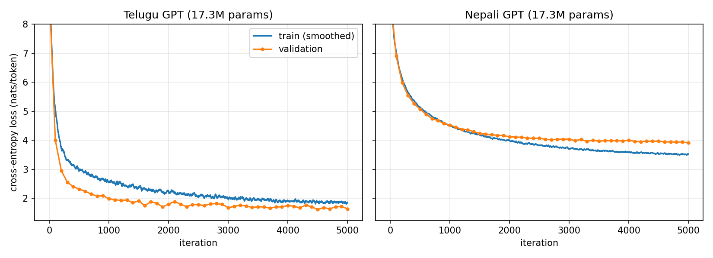

# Telugu and Nepali Language Models from Scratch

Two small GPT-style language models (17.3M parameters each), one for Telugu and one for Nepali, built end to end from raw Wikipedia text: data cleaning, tokenizers, model, training and evaluation. Everything is written from scratch in PyTorch; there are no pretrained weights.

**Models on the Hugging Face Hub:** [telugu-gpt-17m](https://huggingface.co/YogeshNarasimha/telugu-gpt-17m) · [nepali-gpt-17m](https://huggingface.co/YogeshNarasimha/nepali-gpt-17m)

[](https://colab.research.google.com/github/Yogesh-Narasimha/telugu-nepali-lm/blob/main/notebooks/demo.ipynb) Try the models in your browser, free, no install.



## Results

Held-out test split (whole articles never seen in training or validation):

| Language | Model | Test loss | Perplexity | Bits/char |
|---|---|---|---|---|
| Telugu | Unigram | 6.466 | 643.2 | 2.001 |
| Telugu | Bigram | 3.417 | 30.5 | 1.057 |
| Telugu | **GPT (17.3M)** | **1.713** | **5.55** | **0.530** |
| Nepali | Unigram | 7.591 | 1979.7 | 3.064 |
| Nepali | Bigram | 6.077 | 435.5 | 2.453 |
| Nepali | **GPT (17.3M)** | **4.203** | **66.9** | **1.697** |

How to read this:

- The GPT beats both n-gram baselines by a wide margin in both languages.
- **Perplexity is per token, and each language has its own tokenizer, so Telugu and Nepali perplexities are not comparable with each other.** Bits per character is the fairer cross-language number.
- Telugu looks much better than Nepali, but part of that is the data, not the model. Telugu Wikipedia is full of very regular text (village, film and place articles built on shared templates). I capped exact and near-duplicate template lines, but the text is still unusually predictable. Treat the Telugu number as "easy domain", not "better Telugu model".
- Nepali's best checkpoint came at iteration 5000 and Telugu's at 4500. I also trained Nepali for 8,000 iterations to check whether more training helps: it did not (best validation loss 3.918 vs 3.908), so the limit is the amount of data (about 8M training tokens), not training time. Logs are in `results/ne_long_log.json`.
- Test splits are small (about 207 Telugu and 267 Nepali articles), so expect some noise between runs and splits.
- The models are trained on Wikipedia only. Samples are fluent but often factually wrong, as expected at this size.

Sample generations are in [results/samples_te.txt](results/samples_te.txt) and [results/samples_ne.txt](results/samples_ne.txt).

## Data

Source: `wikimedia/wikipedia` on HuggingFace, snapshot `20231101` (Telugu `te`, Nepali `ne`).

| | Raw | After cleaning | After near-dedup | Train / val / test articles |
|---|---|---|---|---|
| Telugu | 208.9 MB | 114.1 MB | 90.5 MB | 20,288 / 207 / 207 |
| Nepali | 101.4 MB | 90.7 MB | 88.2 MB | 26,194 / 267 / 267 |

Pipeline (`src/`):

1. `download.py`: stream Wikipedia, cap at about 200 MB per language (Nepali is smaller than the cap, so all of it is used).
2. `clean.py`: NFC normalisation, remove URLs and short lines, keep lines that are at least 70% in the right script (Telugu U+0C00–0C7F, Devanagari U+0900–097F), exact-duplicate removal. Counts after every step are saved to `data/stats.json`.
3. `near_dedup.py`: caps lines that share a template and differ only in names or numbers (for example thousands of village stubs). Keeps at most 3 lines per template.
4. `split.py`: 98/1/1 split **by article** with a fixed seed, so lines from one article never appear in both train and test.

## Tokenizers

SentencePiece Unigram models at 4k, 8k and 16k vocabulary (`src/tokenizer.py`), compared on the test split. Tokens per word (lower is better):

| Vocab | Telugu | Nepali |
|---|---|---|
| 4,000 | 1.72 | 1.89 |
| 8,000 | 1.61 | 1.66 |
| 16,000 | 1.52 | 1.51 |

I used 8,000 for both: most of the gain, and half the embedding cost of 16k, which matters in a 17M-parameter model. Full numbers are in `results/tokenizer_comparison.json`. The models have no byte fallback, so about 0.08% of test tokens are `<unk>`.

## Model

Decoder-only transformer (`src/model.py`, config in `configs/gpt_17m.json`): 8 layers, 8 heads, width 384, context 256, vocabulary 8,000, pre-LayerNorm, learned positional embeddings, tied input/output embeddings, GELU MLP, no biases. 17.33M parameters.

## Training

`src/train.py`: AdamW (lr 6e-4, weight decay 0.1, betas 0.9/0.95), 200 warmup steps then cosine decay to 6e-5, gradient clipping at 1.0, bf16, 32k tokens per step, 5,000 steps. Validation loss every 100 steps; the best checkpoint is kept. About 45 minutes per language on a laptop RTX 3050 (6 GB).

## Reproduce

```bash
pip install -r requirements.txt
python src/download.py
python src/clean.py
python src/near_dedup.py
python src/split.py
python src/tokenizer.py
python src/prepare_data.py
python src/train.py te --max-iters 5000
python src/train.py ne --max-iters 5000
python src/evaluate.py
python src/generate.py te "తెలుగు భాష" --tokens 80
python app.py                     # local web demo (or open notebooks/demo.ipynb in Colab) (Gradio) at http://127.0.0.1:7860
python src/upload_hf.py           # optional: publish to the Hub (needs huggingface-cli login)
```

`run_pipeline.sh` runs everything from the split onwards. Data and checkpoints are not committed (see `.gitignore`).

## Limitations

- Wikipedia only: encyclopedic style, no conversational, news or social text.
- Small models and small data (about 8–9M training tokens each), so they overfit if trained much longer and invent facts.
- Test sets are small, and the Telugu number is flattered by very regular source text.
- Near-duplicate filtering uses a simple frequent-word "skeleton" heuristic, not a full MinHash approach.
- Single training run per language, no seed variance reported.
